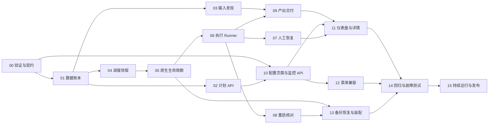

# 自动化开发任务分工与执行计划

状态：待评审，所有开发任务未开始。对应 [详细设计](../specs/自动化详细设计.md)。人或开发 Agent 都可以承接以下角色；同一人可以兼任，多 Agent 也可以协作，但每个任务只有一个交付负责人。

本文件是任务分配方案，不代表已创建开发 Agent、已指派员工或已开始运行业务任务。本轮仅交付文档，不修改运行系统；文档提交已获用户授权，推送、开发和发布仍需后续授权。

## 1. 角色与责任

| 角色 | 负责结果 | 主要任务 | 不应自行改变的边界 |
| --- | --- | --- | --- |
| R0 产品与架构负责人 | 范围、业务样例、接口与状态定稿，组织集成评审 | T00，全程评审 | 不将通用平台改成专利专用产品 |
| R1 后端数据与 API | 两种数据库迁移、事务、计划及查询接口、归属校验 | T01、T02、T04 数据部分、T10 API | 不在 HTTP 层写调度和 SQL |
| R2 调度与执行 | 容量、租约、Runner、人工恢复、重启核对、启停 | T04、T05、T06、T07、T08、T13 | 不以停止专家替代取消任务，不自动同意工具请求 |
| R3 输入与产出 | 目录发现、快照、去重、通用校验和 ZIP | T03、T09，协作 T08 | 不绕过 BackendWorkspace，不写领域分析逻辑 |
| R4 前端产品界面 | 计划配置、运行监控、操作及菜单兼容 | T10 页面、T11、T12 | 不改变旧菜单、默认聊天或现有专家配置流程 |
| R5 测试与发布 | 测试矩阵、故障注入、负载、持续运行、灰度和回退证据 | T14、T15，提前参与 T00 | 不把短时通过写成 7×24 已验收 |

小团队可由一名后端兼 R1/R3，一名后端承担 R2，一名前端承担 R4，产品/架构和测试按阶段参与。单人可按同一顺序串行执行；任务设计不依赖固定人员数量。

## 2. 公共交付规则

1. T00 先冻结 ID、状态、请求/响应、错误码、事件、输入/产出协议和测试样例。接口变化由 R0 记录，通知受影响角色。
2. 开发 Agent 接单时必须收到需求、设计、任务编号、代码基线、允许改动文件及验收命令；不得自行扩展范围。
3. `server.py`、`services.py`、错误/i18n 和路由装配等共享文件由集成负责人协调顺序，避免多个承接者同时修改。
4. 每个任务提交交付清单、变更文件、验证结果、未解决问题；自测后由另一个角色复核。不能仅报告“代码写完”。
5. 下列测试路径以 `拟新增` 标注的属于待建测试，不是现有测试。只写有业务意义的事务、权限、恢复与兼容测试，不以逐行镜像实现充数。
6. 如后续授权提交：按可审查任务包提交，装好仓库 hooks，提交前 `make all` 和前端构建通过；不跳过 hooks，不自行推送或发布。正式开发前核对 AGENTS 与 fork 归档说明中的分支规则差异，由维护者确定该 fork 的开发/发布目标；本次文档不改变分支。

## 3. 开发顺序与接口依赖



可并行：T00 后前端按契约用 mock 开发；T01 后 T02/T03/T04 并行。T07 和 T08 可以分别开发，但共同的 Runner 状态与恢复接口由 R2 统一。验收先打通手动端到端，再启用目录和定时。

以下工作量为初步“有效工作日”，不包含等待评审、模型外部服务故障及业务 Skill 本身开发；任务包可部分并行，不能简单相加成日历工期。

## 4. 任务包

### T00 范围、契约与技术验证

- [ ] 负责人：R0；协作：R1/R2/R3/R5。依赖：无。参考工作量：2–3 日。
- 输入：本次需求、调研、设计及当前代码。
- 文件：本版本 specs、ADR、plans；必要的临时验证脚本仅放受控临时目录，不引入外部服务。
- 交付：契约表、两种业务测试 Skill 样例及预期产出、普通专家执行/取消/人工恢复实测、工作空间 I/O 能力核对、迁移编号与默认参数决定。
- 接口：冻结 PlanConfig、Run/Attempt 状态、事件 seq、请求幂等规则、Runner/Workspace/Artifact 域接口、Skill 校验协议。
- 验收：专属会话不改变默认聊天；每次执行/恢复段用量只记一次；重启后的 checkpoint 可核对。若关键恢复能力缺失，写明补齐任务，不带着未知项进入发布。
- 提交建议：后续授权后单独提交评审定稿文档；不与运行代码混在一个提交。

### T01 持久化模型、仓储与迁移

- [ ] 负责人：R1；复核：R2/R5。依赖：T00。工作量：3–4 日。
- 文件：`infra/automation/models.py`、`infra/db/repos/automation_*.py`、`infra/db/services.py`、编号 SQL/PG 对、`tests/unit/db/test_db_pool.py`。
- 交付：设计中的九张表、typed rows、RepoBundle 装配、事务与索引；旧表内容保持不变。
- 接口：计划/版本 CRUD、内容输入去重、Run 创建、状态条件更新、Attempt/Artifact/事件登记、协调租约、持久化请求去重及结果。仓储只承担 SQL。
- 验收：旧库升级和再次迁移；公开 ID/FK 规则；SQLite/PG 一致；同输入竞争只创建一次；迁移不丢旧用户/专家/Cron。
- 测试：现有 `tests/unit/db/test_db_pool.py`；拟新增 `tests/unit/db/test_repo_automation.py` 与 PG 集成用例。
- 提交建议：schema、仓储、迁移及对应测试作为同一可审查包。

### T02 计划管理与原生 API

- [ ] 负责人：R1；复核：R0/R4。依赖：T01。工作量：2–3 日。
- 文件：`infra/automation/manager.py`、`api/routers/automation.py`、`api/app.py`、`api/openapi_meta.py`、`infra/errors.py` 及对应中英文错误键。
- 交付：计划增改查、validate/enable/pause/archive，配置版本及归属校验，分页和幂等。
- 接口：设计第 9 节计划 API；expected_revision 编辑冲突返回 409，保存不触发模型。
- 验收：用户不能引用他人专家或计划；拒绝团队专家和越界配置；暂停才可编辑；专家删除保持原删除行为，计划显示不可执行。
- 测试：拟新增 `tests/integration/test_automation_plans_api.py`；i18n parity；Scalar 请求响应可读。
- 提交建议：计划域行为和 HTTP 适配保持同包，后续监控接口单独提交。

### T03 输入发现、上传与快照

- [ ] 负责人：R3；复核：R1/R5。依赖：T01、T00 的 Workspace 契约。工作量：3–4 日。
- 文件：`infra/automation/discovery.py`、必要的 `manager.py`/仓储方法、上传 HTTP 适配；仅在缺失时补通用 Workspace 接口。
- 交付：稳定扫描、内容账本、首次基线、定时触发键、输入快照、手动上传以及新文件入队。
- 接口：`discover(plan_id)` 返回接收/跳过/错误数量；创建 Run 使用持久化唯一 trigger_key；上传返回限定 plan 的 upload_id。
- 验收：半写文件不入队；内容去重和改名行为正确；修改同名文件产生新 Run；重启不重建基线；输出/快照不再被发现；源文件保持原样。
- 测试：拟新增 `tests/unit/automation/test_discovery.py`，覆盖本地与模拟远程后端、分页、不可达、同元数据内容变化。
- 提交建议：扫描及其数据事务同包；上传接口可单独审查。

### T04 调度领取、配额与租约

- [ ] 负责人：R2；协作：R1。依赖：T01。工作量：3–4 日。
- 文件：`infra/automation/scheduler.py`、领取/容量/租约仓储方法、域状态模型。
- 交付：单实例协调、用户/计划轮转、FIFO、全局/专家/计划容量、独立心跳、租约 token、重试退避。
- 接口：`claim_next()` 返回有 token 的 Attempt；`renew_lease()`、`transition(expected_state, token)`；所有执行工作在 DB 事务外。
- 验收：竞争领取唯一；过期执行者不能提交；容量不超限；暂停不能继续取；未知旧任务不释放专家位置后重新调用。
- 测试：拟新增 `tests/unit/automation/test_scheduler.py`、竞争事务集成用例，使用可控时间，不用长时间 sleep。
- 提交建议：调度规则与原子仓储契约一起提交，Runner 另包。

### T05 原生启停与功能开关

- [ ] 负责人：R2；复核：R1/R5。依赖：T04。工作量：1–2 日。
- 文件：`config.py`、`infra/server.py`、`infra/automation/manager.py`，现有生命周期测试及拟新增启动测试。
- 交付：原生 automation_enabled/并发配置、AppRuntime 装配、启动先核对后领取、停止先停自动化后停 Agent/DB、健康状态。
- 接口：`start()`、`quiesce()`、`stop()`、`health()`；保持原 Server 使用方式及返回契约。
- 验收：默认停用不扫描、不调用模型；后台单循环错误不使聊天服务退出；退出不会写已关闭 DB；旧 Cron/备份/TLS 原调度不改。
- 提交建议：仅纳入生命周期接线及其测试，禁止顺便重构 server.py。

### T06 原生 Agent Runner 与执行记录

- [ ] 负责人：R2；复核：R0/R5。依赖：T05。工作量：3–4 日。
- 文件：`infra/automation/runner.py`；必要的 `infra/gateway/process/` 公共执行观察 helper、`infra/history/` 接口；尽量不改 AgentManager。
- 交付：输入上下文、输出前缀、专属 ThreadRegistry 会话、stream 观察、历史/轨迹/用量关联、执行段唯一记录、线程取消及超时。
- 接口：`execute(claimed_attempt)` 输出事件和最终执行结果，不自己取下一任务；run/attempt/segment 关联稳定。
- 验收：正常聊天默认会话不切换；同专家其他会话不被取消；流 error 后 done 不记成功；用量只登记一次；状态未知进入核对。
- 测试：拟新增 `tests/unit/automation/test_runner.py`；现有 `tests/unit/gateway/test_hitl_stream_compat.py` 和历史/用量相关测试。
- 提交建议：若提取共享 helper，先单独提交且证明普通聊天行为不变，再提交 Runner。

### T07 人工等待与双入口恢复

- [ ] 负责人：R2；复核：R1/R5。依赖：T06。工作量：2–3 日。
- 文件：Runner/Manager、`infra/gateway/hitl/` 的窄接口、既有聊天恢复的域分发点、新自动化 resume API。
- 交付：持久化待决策及 checkpoint 引用，重建在线 pending 状态，专属 resume 入队、同 Attempt 恢复，聊天入口定向分发。
- 接口：`resume(run_id, pending_id, decision, request_id)`；普通聊天线程保持原行为；自动化线程统一经过运行状态与容量判断。
- 验收：批准/拒绝/问答有效；双击与两个入口竞争只恢复一次；重启后可确认；checkpoint 无效显示可操作原因；不自动批准。
- 测试：现有 `tests/unit/api/test_hitl_resume_validation.py`、`tests/unit/gateway/test_hitl_resume_projection.py`；拟新增 `tests/integration/test_automation_hitl.py`。
- 提交建议：等待持久化、分发与恢复以一个闭环提交，不能留下双入口绕过租约。

### T08 重启核对与安全重试

- [ ] 负责人：R2；协作：R3/R5。依赖：T06，T07 提供人工契约。工作量：2–3 日。
- 文件：`infra/automation/recovery.py`、Runner/Manager、核对仓储查询。
- 交付：各状态恢复表、租约失效检测、外部工具活动核对、未发布产出恢复、待人工原因和专家配置变化处理。
- 接口：`reconcile(run_id)` 返回核对依据与下一状态；未知不等于失败、不等于可重试。
- 验收：不同故障点恢复不重复执行；副作用未知留人工；产出已写但未提交可继续发布；过期执行者不能覆盖新结果。
- 测试：拟新增 `tests/integration/test_automation_recovery.py`，在调用前、调用中、打包和提交前后注入故障。
- 提交建议：恢复规则和故障测试同包；不把全部非终态直接改为 queued。

### T09 产出校验、登记与 ZIP

- [ ] 负责人：R3；复核：R0/R5。依赖：T03/T06。工作量：3–4 日。
- 文件：`infra/automation/artifacts.py`、Artifact 仓储、下载 API；工作空间 I/O 必须沿用已有入口。
- 交付：必需文件规则、通用 JSON 校验、Skill 校验结果协议、manifest、受控 ZIP、幂等发布、失败尝试隔离。
- 接口：`validate_and_publish(attempt_id, token)`；下载按 artifact_id，不接受任意工作空间路径。
- 验收：文件缺失/空/坏 JSON/坏 ZIP 不成功；打包失败可续做、不重新分析；完整读取和 hash 一致；不包含认证和无关文件。
- 测试：拟新增 `tests/unit/automation/test_artifacts.py`；现有 `tests/unit/test_workspace_download.py` 定向回归，模拟远程 I/O。
- 提交建议：校验和发布为一个闭环；可将下载适配独立提交。

### T10 监控查询 API 与计划配置页面

- [ ] 负责人：R1（API）、R4（页面），分别对各自交付负责；接口合并由 R0 复核。依赖：T00/T02；用量/事件接入依赖 T06。工作量：API 1–2 日，页面 2–3 日。
- 文件：监控仓储/Manager、automation router；`dashboard/src/api/modules/automation.ts`、`pages/automation/`、前端中英文资源。
- 交付：overview、health、列表/详情查询、事件 seq/SSE；计划表单、专家选择、目录选择、配置校验、草稿保存及启用。
- 接口：设计第 9 节，前端按 typed fetch；错误码、分页、UTC 时间和服务器时区一致。mock 只用于开发，不作为交付数据。
- 验收：保存不执行；目录说明清楚；已有专家跳转正确；校验与后端一致；日期展示使用服务器时区；权限失败有明确提示。
- 测试：API 集成测试、前端类型检查、浏览器表单端到端；无直接 fetch 和硬编码用户文案。
- 提交建议：API 与页面分开提交，必须使用同一冻结类型契约。

### T11 仪表盘、运行详情与操作

- [ ] 负责人：R4；复核：R0/R5。依赖：T10，联调依赖 T07/T09。工作量：3–4 日。
- 文件：`pages/automation/`、必要共享组件、automation API wrappers、前端 i18n。
- 交付：概览、计划运行列表、尝试时间线、状态与原因、重试/重跑/取消/人工处理、文件与产出包下载、断线恢复。
- 接口：概览按 Run 去重；SSE after_seq；禁止客户端从流结束猜成功。
- 验收：重试不增加完成数量；重跑保留原结果；取消请求显示“取消中”；没有步骤协议不造进度；SSE 断线不停止任务。
- 测试：真实 API 浏览器联调，等待人工、失败、恢复和成功分别录制或截图；`npx tsc -b`、构建。
- 提交建议：列表/概览和详情/人工操作可分成两个小提交。

### T12 导航与存量偏好兼容

- [ ] 负责人：R4；协作：R1。依赖：T10。工作量：1 日。
- 文件：`dashboard/src/layouts/sidebarNav.tsx`、`sidebarNavLayout.ts`、`routes/index.tsx`、`infra/users/preferences.py`、导航文案。
- 交付：任务下方 automation、旧布局补新项、显式隐藏优先、编辑器一致、前后端允许键同步。
- 接口：仅对缺失 automation 的有效布局做适配，不持久化覆盖旧布局。
- 验收：默认/自定义分组/任务隐藏/automation 显式隐藏四类正常；原 fork 隐藏项不恢复。
- 测试：现有 `tests/unit/users/test_preferences.py`、`tests/integration/test_preferences_api.py`；前端布局逻辑测试与浏览器核对。
- 提交建议：导航适配独立提交，便于审查是否影响存量菜单。

### T13 备份恢复、重绑定与安装集成

- [ ] 负责人：R2；协作：R1/R3/R5。依赖：T05/T08。工作量：1–2 日。
- 文件：`infra/server.py` 的服务重绑定、备份恢复的已有调用点、Workspace 备份说明及自动化文档。按必要范围改动。
- 交付：恢复前异步 quiesce、再执行现有同步 replace_services 并绑定新 repo，恢复后核对；数据库与工作空间备份范围说明；沿用原有 Octop 服务部署。
- 接口：旧池关闭前停止旧写入，禁止在同步 replace_services 内用阻塞等待模拟异步排空。
- 验收：恢复过程中不领取；恢复后不使用旧连接池；只有 DB 无产出文件时明确标记文件缺失；旧备份流程正常。
- 测试：现有 `tests/unit/api/test_backup_restore_rehydrate.py`、`tests/unit/backup/test_system_archive.py`；拟新增活动自动化任务恢复用例。
- 提交建议：服务切换与备份测试同包，不另造安装服务。

### T14 故障、存量回归与负载验收

- [ ] 负责人：R5；各模块负责人修复本模块问题。依赖：T03–T13 完成联调。工作量：3–4 日。
- 文件：拟新增 `tests/unit/automation/`、`tests/integration/test_automation_*.py`，本版本验收记录；按现有 pytest/平台规范。
- 交付：设计第 12 节矩阵执行结果、SQLite/PG 迁移结果、普通聊天/Cron/专家/工作空间/导航/备份回归、负载对比。
- 接口：记录环境、版本、模型、存储、全局并发、样本数和 p95；平台错误与外部 Provider 错误区分。
- 验收：`make all`、前端 `npx tsc -b`/构建、i18n 和 Scalar 通过；零越权、零未授权重复执行；旧功能错误率不增加，负载指标符合 T00 确认门槛。
- 提交建议：测试与必要修复按问题包提交；不要在验收阶段扩大需求。

### T15 24/72 小时试运行与灰度发布

- [ ] 负责人：R5；发布决定：维护者；协作：R0/R2/R3。依赖：T14。投入：1–2 日操作与分析，另加连续试运行观察窗口。
- 文件：本版本 `research/验收记录.md`（实施后新建）、CHANGELOG、运维及回退说明。
- 交付：24 小时及 72 小时记录、两类业务样例产出、故障恢复记录、容量建议、已知限制、停用/回退演练。
- 验收：输入账本与运行/尝试/产出对账；重复自动执行为 0；等待人工明确；内存无持续无界增长；期间既有聊天/Cron 可用。
- 发布：先默认关闭随原生包部署，再小范围启用；达到门槛才扩大。发布、部署及推送需要后续明确授权，不由本次文档请求自动触发。
- 提交建议：验收和发布记录单独归档；记录实测值，不填估计值冒充结果。

## 5. 里程碑与完成定义

| 里程碑 | 达到条件 | 不能据此宣称 |
| --- | --- | --- |
| M0 可开工 | T00 关键验证和设计评审完成 | 生产可用 |
| M1 手动闭环 | 数据/API/Runner/产出，手动运行可下载 | 已完成持续调度 |
| M2 自动运行 | 目录/定时/配额/重试/人工/重启恢复联调 | 已完成 7×24 验收 |
| M3 原生产品完整 | 菜单/表单/仪表盘/备份/语言时区集成 | 存量负载无影响 |
| M4 可发布 | 回归、负载、持续运行和回退验证完成 | 任意 Skill 的业务结论都正确 |

初步预算约 40–60 个有效工作日，包含集成与质量保障；角色可以并行。按两名后端、一名前端、产品/测试阶段参与估计约 5–7 周；单人承担全部工作约 9–13 周，另受连续观察窗口和外部服务影响。该范围是详细设计后的规划估算，T00 技术验证后修订，不作为固定交付承诺。

## 6. 可直接交给人或 Agent 的任务单模板

```text
任务编号：Txx
承接角色：Rx；交付负责人：待填
基线提交：待开工时核对
必读：本版本需求、详细设计、ADR、当前任务包、根 AGENTS.md
允许改动文件：按任务包；共享文件先与集成负责人协调
输入/依赖：明确上游任务交付与接口版本
交付物：代码/测试/文档/运行证据及实际路径
验收：具体命令、预期行为、必测失败与恢复场景
禁止扩展：不改业务范围、不改其他角色接口、不动用户存量数据
提交权限：按当前用户授权；默认不提交、不推送、不发布
完成回报：变更摘要、验证结果、未解决项、下一依赖方
```

执行中将对应 checkbox 更新为完成并附证据链接。未运行测试、依赖未交付、人工恢复或产出校验未闭环的任务，不标记完成。
