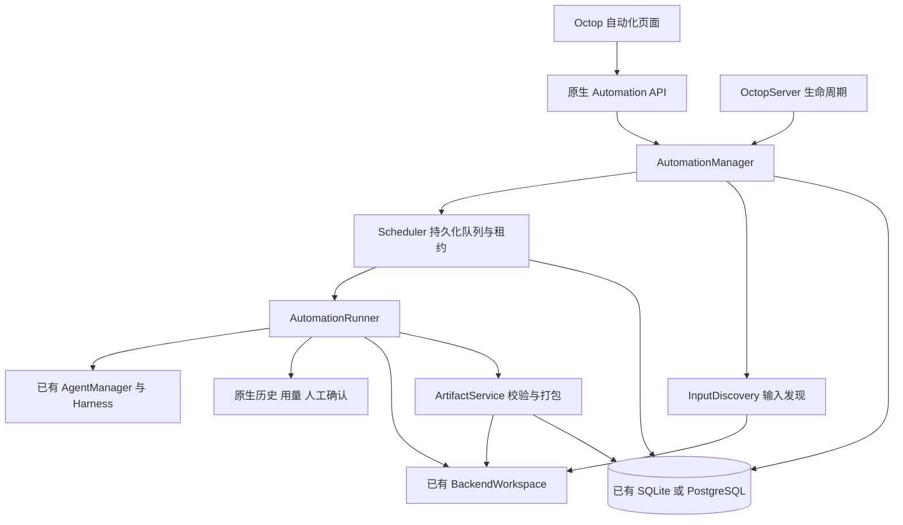
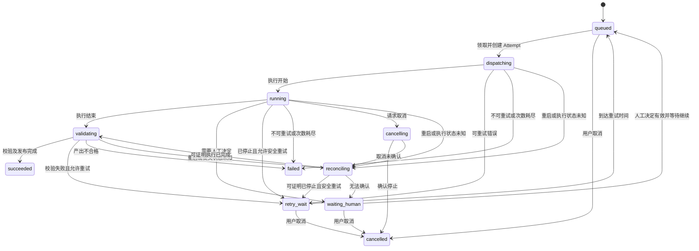

# Octop 原生自动化详细设计

状态：待评审设计稿。日期：2026-10-11。对应 [需求](../requirement/自动化需求.md)、[代码调研](../research/自动化代码调研.md)、[架构决策](../ADR.md)、[任务分工](../plans/自动化任务分工.md)。

本文定义待开发行为；模块名、接口和默认值是设计约定，尚未实现。文档版本 `v1.0.3` 不修改当前包版本。目标是完善 Octop 的原生自动化能力，业务分析方法继续由已有专家和 Skill 提供。

## 1. 产品边界与核心概念

| 概念 | 用户理解 | 平台职责 |
| --- | --- | --- |
| 专家 | 谁来执行 | 引用现有普通专家、模型、工具和 Skill |
| 自动化计划 Plan | 长期做什么，什么时候做 | 保存任务、触发、输入、输出及运行规则 |
| 运行 Run | 一份输入的一次处理要求 | 固定输入和配置，记录业务结果 |
| 执行尝试 Attempt | 这次运行的第几次执行 | 独立线程、租约、日志、费用用量和产出目录 |
| 产出 Artifact | 可查看、可下载的交付物 | 校验、登记、打包，保留来源及校验结果 |

“调度不同窗口”在产品中体现为不同的执行会话。后台直接调用 Octop Agent 域接口，用户不用维持浏览器窗口；关闭仪表盘不会停止已启动的服务端执行。

首版一个计划只绑定一个普通专家，团队专家暂不支持。支持多个计划并行，暂不增加可视化步骤编排和专家间传递。新业务只需配置专家、Skill 和计划，平台代码不判断业务种类。

## 2. 菜单与页面

### 2.1 导航

新增同级菜单「自动化 / Automation」，默认顺序为「专家 → 任务 → 自动化 → 用量统计」。沿用现有导航样式和权限入口，路由根为 `/automation`。

旧布局兼容规则：

1. 无自定义布局时使用新默认目录。
2. 已保存布局没有 `automation` 键时，在可见 `tasks` 后面补入新项，保持同组；任务不可见或不存在时，放到未分组区域。
3. 若布局已显式将 `automation` 隐藏，则尊重隐藏。
4. 只补这个新键，不改变旧项顺序、分组或隐藏状态，也不自动覆盖数据库中的原布局；编辑器与展示使用同一有效布局。
5. 前后端导航允许键同步增加，保持 fork 已隐藏功能的现有规则。

### 2.2 页面结构

| 页面 | 路由 | 主要内容 |
| --- | --- | --- |
| 自动化主页 | `/automation` | 概览、计划列表、筛选、新建入口 |
| 新建计划 | `/automation/new` | 选择专家及任务、触发、输入输出、运行规则 |
| 计划详情 | `/automation/plans/:planId` | 配置摘要、运行列表、计划事件、启用与暂停 |
| 编辑计划 | `/automation/plans/:planId/edit` | 仅草稿或已暂停计划可编辑 |
| 运行详情 | `/automation/runs/:runId` | 状态、输入、尝试时间线、人工处理、产出下载 |

主页布局示意：

```text
自动化                                      [新建计划]
已启用计划  待处理  运行中  今日成功  今日失败  待人工
运行服务：正常 / 正在恢复 / 暂停 / 不可用；最近心跳时间

[状态筛选] [专家筛选] [搜索计划]
计划名称 | 专家 | 触发方式 | 状态 | 待处理 | 运行中 | 成功/失败 | 最近运行 | 操作
专利分析 | 分析专家 | 目录新文件 | 已启用 | 12 | 1 | 34/2 | 10:32 | 详情 / 暂停 / 立即运行
资料整理 | 整理专家 | 每日定时   | 已暂停 |  0 | 0 | 20/0 | 昨日  | 详情 / 启用 / 编辑
```

专利分析只是示例名称，页面字段完全通用。指标显示实际汇总结果，不给没有步骤协议的 Agent 编造百分比进度。

### 2.3 计划配置

| 区域 | 字段 | 首版约定 |
| --- | --- | --- |
| 基本信息 | 名称、说明、专家 | 从当前用户已有普通专家中选择；显示 Skill 摘要及专家配置入口 |
| 任务 | 任务指令 | 文本说明目标、约束及交付要求；不依赖页面生成业务分析逻辑 |
| 触发 | 手动、定时、目录新文件 | 单选；定时使用现有 Cron 表达式语法与服务器时区 |
| 输入 | 无文件、上传、工作空间目录 | 上传用于手动；定时可选无文件或目录；目录触发必须配置目录 |
| 目录规则 | 路径、递归、扩展名、首次处理已有文件 | 相对所选专家工作空间；显示服务端存储位置，不误导为浏览器本地目录 |
| 输出 | 输出目录、必需文件规则、是否打包 | 默认 `outbound/automation`；打包默认开启；目录是交付根，系统追加计划和运行层级 |
| 执行 | 计划并发、执行超时、自动重试次数 | 计划并发默认 1；默认执行超时 30 分钟；默认最多自动重试 2 次 |
| 恢复策略 | 外部副作用声明 | 默认“可能有副作用”；只有明确“可安全重试”的任务允许自动重跑执行阶段 |

运行参数是首版建议默认值，技术试运行后由 T00 定稿。每专家自动化并发首版固定为 1；全局自动化并发建议 2，由原生服务配置限制，普通用户不能提升全局上限。

必需文件规则首版只支持相对路径或 glob、允许空文件与否、可选 JSON 解析检查；不允许在表单输入任意 shell 校验命令。业务质量检查由 Skill 输出规范化校验结果，平台只执行通用门槛。

保存前检查专家归属、专家类型、路径范围、Cron、并发及超时范围、输入输出关系、必要产出声明。新建默认草稿，完成校验后用户启用；不因保存而立即扫描或调用模型。

### 2.4 操作语义

| 操作 | 准确行为 |
| --- | --- |
| 启用 | 开始发现工作并允许取队列；首次启用执行基线策略 |
| 暂停 | 停止该计划扫描、定时入队及取队列；运行中的任务继续完成 |
| 立即运行 | 无文件计划创建一条运行；目录计划立即扫描待处理新文件；不自动重做已完成文件 |
| 重试 | 对失败运行增加一次 Attempt，保持该 Run 的输入和配置快照；成功运行不可使用此操作 |
| 重跑 | 创建关联原 Run 的新 Run；默认沿用原快照，可明确选择当前计划配置；保留原结果 |
| 取消运行 | 指定会话取消；排队任务直接取消；执行任务等确认停止后终结 |
| 归档计划 | 仅暂停且无活动执行时可归档；隐藏默认列表，保留全部记录与文件 |
| 下载 | 仅提供已登记、归属正确的文件；产出包校验通过后可下载 |

首版不提供自动删除输入、历史或产出。无需用一次页面删除改变存量专家或 Skill。

## 3. 原生模块架构



拟新增目录：

```text
src/octop/infra/automation/
  models.py             # 域对象、状态、校验规则及配置快照
  manager.py            # 计划/运行操作、权限边界、统一入口
  scheduler.py          # 入队、领取、资源配额、心跳、公平性
  runner.py             # 原生 Agent 执行、观察记录、人工恢复、取消
  discovery.py          # 定时与目录发现、稳定检测、输入快照
  artifacts.py          # 通用验收、manifest、打包、发布
  recovery.py           # 重启与不确定状态核对
src/octop/infra/db/repos/automation_*.py  # SQL 仓储，无业务编排
src/octop/api/routers/automation.py      # HTTP 验证与错误映射
dashboard/src/api/modules/automation.ts # 类型与请求封装
dashboard/src/pages/automation/         # 路由页面和页面专用组件
```

这是同一 Python wheel 中的原生模块，不引入 Redis、Celery、独立服务、轮询外部 Octop API 或浏览器自动化。API 只调用域服务；域服务不能导入 API、CLI 或 launch；仓储不调用 Agent。

### 3.1 启停、恢复与功能停用

`OctopServer` 负责装配，`AppRuntime` 持有 `automation_manager`，`RepoBundle` 提供新仓储。通过原生配置 `automation_enabled` 控制后台模块；建议首个发布默认关闭，试运行通过后再扩大启用范围。

- 启动：数据库迁移 → 现有 Agent/Gateway 就绪 → 自动化核对未终结运行 → 开始扫描与调度。
- 停止：禁止新领取 → 请求取消活动会话并保存状态 → 未确认停止的运行记为待核对 → 停扫描和心跳 → 按现有流程停 Agent、Gateway、DB。
- 功能停用：不扫描、不领取、不调用模型；保留表与既有自动化记录。页面显示功能停用及原因，不阻断现有页面。
- `replace_services`：先进入自动化维护状态并停领取，排空或取消旧 DB 上的活动任务；重新绑定新仓储，核对恢复记录后才重新启用。不能继续写已关闭的旧连接池。
- 自动化循环异常：记录健康状态、停止继续取任务并退避恢复；不能传播成整个 Octop 启动或日常聊天不可用。

已有 Cron 的普通任务、备份和 TLS 续期继续走原流程。自动化定时计算可复用已有时间解析逻辑，但不改写原 cron_jobs，也不把普通定时任务转换为自动化计划。

## 4. 输入发现与运行创建

### 4.1 输入策略

首版输入目录和输出目录属于所选专家的工作空间；本地盘、NAS 或远程存储由现有专家存储配置决定。工作空间根路径在配置中使用 `.`；API 层规范化前端路径，内部不使用 backend 根 `/` 代替工作空间根。

目录模式每个文件生成一个 Run。上传多个文件也生成多个 Run。定时目录计划只处理尚未处理的内容；定时无文件计划每个触发时刻生成一个 Run。多文件合并成一个业务任务留到后续输入批次能力。

建议目录扫描间隔 30 秒、连续两次扫描稳定后接收文件；这些是运行参数，实际发现延迟包含扫描、上传稳定和存储延迟。暂停期间到达的文件，在恢复后的扫描中继续发现。

### 4.2 发现算法

1. 获取已启用计划，用工作空间接口列举文件，过滤配置扩展名和系统保留目录。
2. 记录路径、大小、修改信息和观测时间。新文件或发生变化的文件，连续两次观测一致后进入候选。
3. 经流式或分块读取生成输入快照及 SHA-256；复制前后核对源状态，并复核内容摘要，变化则放弃本次接收，继续等待稳定。只有元数据一致不能证明复制内容稳定。
4. 输入快照完成后，在同一数据库事务中登记输入内容版本、创建 Run、追加 queued 事件。重复事务命中唯一键时不再创建。
5. 原输入文件不移动、不删除。读取失败只记来源错误，不将未列出的文件当成已删除。

元数据缓存只是优化；增加低优先级周期内容核对，检测相同大小、相同修改时间但内容变化的情况。扫描和核对要限速、分页，避免远程存储及共享盘被持续遍历占满。首版建议单文件上限 100 MiB，具体沿用现有上传限制或在 T00 定稿；达到限制须展示错误，不静默丢弃。

### 4.3 去重与首次启用

- 自动目录处理以 `(plan_id, input_sha256)` 作为内容去重范围，同名内容变化视为新输入；同内容改名或复制不重复执行。同一内容用于两个计划可以分别执行。
- 输入账本保存“已接收 / 首次基线跳过”，首次启用选择“不处理已有文件”时，将当时稳定内容登记为跳过；以后内容改变才接收。重启不能重复建立首次基线。
- 修改任务指令或专家配置不自动把旧输入全部重做；处理已有内容使用显式重跑。
- 无文件定时运行用 `(plan_id, UTC计划触发时刻)` 去重。默认恢复不补齐宕机期间所有无文件时刻，恢复后按下一次计划运行；目录则补扫未处理输入。
- 立即运行、重跑、重试、恢复均使用用户请求幂等键；重复点击或网络重发返回同一结果。
- 重试只创建 Attempt；重跑创建新 Run，使用独立请求键并记录 `parent_run_id`，不受自动发现的内容去重键阻挡。

### 4.4 路径隔离

输入不得等于输出，输出不得是输入的祖先。输出位于输入目录内部时，自动排除输出子树。系统还必须排除快照目录、所有计划的产出子树、`.octop`、旧认证目录及系统 Skill 等保留路径，防止分析自己的报告、系统文件或令牌。界面显示这些固定排除规则。

路径检查依赖统一工作空间接口和现有安全规则，拒绝越界、`..` 逃逸与不允许的绝对路径。不能仅做字符串前缀判断；平台相关符号链接测试按仓库规则加 POSIX 限制。

## 5. 数据模型与事务

SQLite 与 PostgreSQL 使用相同逻辑模型。资源表使用整数 surrogate `id`，公开 ID 为独立字符串（ULID），内部资源关联使用公开字符串 ID，用户归属仍使用整数 `user_id`。

| 表 | 主要字段 | 索引与约束 |
| --- | --- | --- |
| automation_plans | plan_id、owner_user_id、name、state、agent_id、current_revision、last_scan_at、next_fire_at、health_reason | owner+state；agent_id 引用公开 Agent ID，删除专家时 SET NULL，不能阻止原有删除流程 |
| automation_plan_versions | version_id、plan_id、revision、config_json、expert_fingerprint、created_at | plan+revision 唯一；配置版本不可修改 |
| automation_inputs | input_id、plan_id、sha256、source_metadata_json、snapshot_path、disposition、first_seen_at | plan+sha256 唯一；保存首次基线及内容去重账本 |
| automation_runs | run_id、plan_id、version_id、input_id、owner_user_id、trigger_key、parent_run_id、status、current_attempt_id、attempt_count、available_at、started_at、finished_at、last_error_code | plan+trigger_key 唯一；status+available_at；owner+created_at |
| automation_attempts | attempt_id、run_id、number、agent_id、agent_snapshot_id、thread_id、session_key、status、lease_owner、lease_token、lease_expires_at、heartbeat_at、output_prefix、checkpoint_ref、expert_fingerprint、usage_refs_json | run+number 唯一；lease_expires_at；thread 关联可空且 SET NULL |
| automation_artifacts | artifact_id、run_id、attempt_id、relative_path、kind、size、sha256、validation_status、published_at | attempt+relative_path 唯一；只登记限定产出前缀下的文件 |
| automation_events | id、run_id 或 plan_id、seq、type、payload_json、created_at | 按所属实体+seq 唯一；追加日志，不需要每条公开 ULID |
| automation_scheduler_state | 固定 scheduler_key、instance_id、lease_token、expires_at、heartbeat_at | 内部单例协调行，不作为用户资源 |
| automation_requests | owner_user_id、request_id、action、target_id、payload_hash、status、result_json、created_at | owner+request_id 唯一；内部命令幂等账本，不作为业务资源 |

配置 JSON 使用有 schema 版本的 typed model，不能直接把未验证的 HTTP dict 持久化。Run 绑定创建时的计划版本、输入快照和专家指纹；Attempt 记录实际开始时指纹。审计用的 `agent_snapshot_id` 是历史值，不因现有专家删除丢失。

专家指纹包含执行相关配置及已安装 Skill 的版本/内容摘要；不存 API Key。当前专家执行条件与保存配置不一致时，计划显示“配置已变化”，暂停领取并要求用户重新校验保存；正在执行时检测到变化，标记不可确认，不能声称结果来自原冻结配置。首版不另造完整专家克隆和版本运行时。

关键事务：

1. 接收输入与创建 Run、去重键、事件一起提交。
2. 领取 Run、创建 Attempt、更新运行状态、容量占用与事件一起提交。
3. 每次状态改变执行 expected-state / lease-token 条件更新，提交事件；过期执行者不能更新结果。
4. 发布产出引用与 Run 成功状态一起提交，事务前必须已有完整且可读取的文件。
5. 数据库事务中不能等待 LLM、工作空间读取、压缩或网络。同步 DB/文件重操作按现有 executor 边界执行，不阻塞 asyncio 主循环。

变更请求先登记 request_id 和规范化请求摘要，业务状态与请求结果在同一事务确认；同键同内容返回既有结果，同键不同内容返回 409。目录立即扫描等耗时操作返回已受理状态，由域服务消费持久化请求；重启后从请求账本核对未结束命令，不能把幂等键仅保存在内存。

迁移编号由 T00 确认：若目标已存在 v20 数据库或 v20 已发布，增加下一编号 SQL/PG 对；只有符合仓库“未发布版本合并且已应用数据库不会漏变更”的条件时才折入当前迁移。更新版本断言，并测试旧库保留、重复迁移和两种数据库。不得仅修改已执行的迁移文件。

## 6. 状态、调度与重试

### 6.1 状态机

计划状态为 `draft / enabled / paused / archived`；健康情况单独表达，不将“某次失败”直接变成计划暂停。



`waiting_human` 同时涵盖工具确认、补充信息和恢复核对，详情用 reason 区分。人工恢复保留原 Attempt；排队时标记 `action=resume`，取得执行容量后继续。它不是一次重试，也不增加尝试次数。其他重试必须创建新 Attempt。

所有活跃状态只允许一个当前 Attempt。开始时间、结束时间和原因由服务端记录；浏览器只显示状态，不推导运行是否成功。

### 6.2 调度算法

首版仅支持一个活动 Octop 服务进程。数据库协调行阻止误启动的第二个调度器继续领取；它不是多机高可用或分布式执行承诺。

1. 获取调度器租约，核对旧执行后开始循环。
2. 按用户、计划轮转选择可运行项，计划内 FIFO；重试到期项不永久压住新任务。
3. 核对计划启用、专家存在且可用、配置指纹一致、全局/专家/计划容量及退避状态。
4. 原子领取并创建或恢复 Attempt，Runner 在事务外执行。
5. 独立心跳建议每 15 秒更新，执行租约建议 90 秒；心跳代表执行者存活，不代表分析取得业务进展。
6. 运行结束更新状态并释放容量；等待人工只有在 Harness 段结束且没有未确认的活动工具时释放执行容量。

`dispatching/running/validating/cancelling` 占用容量；`reconciling` 中尚未证明停止的执行保留对应专家占用，防止重复调用。处理这些占用时必须保留跨重启的真实阻塞原因，不能只数内存 Task。

自动化不会获得现有聊天全局抢占权。同一专家日常聊天仍可能与自动化共享文件和内存，因此建议创建专门的业务专家用于自动化，再在计划中选择它。不会自动克隆、修改或暂停用户现有专家。实际负载影响通过配额和测试控制，不能承诺新增后台任务绝对零资源影响。

所选专家若被用户停止或删除，计划展示“专家不可用”，不自动推翻用户的停止操作；用户从已有专家页面启动或重新选择专家后，重新校验计划。暂停计划仍允许查看、取消和处理人工决定，但不会开始新的执行或恢复段；手动立即运行要求计划已启用。

### 6.3 重试、限额与取消

| 原因 | 默认处理 |
| --- | --- |
| 尚未调用 Agent 时的短暂存储/网络错误 | 指数退避，受次数限制 |
| Provider 限流或明确瞬时错误 | 仅确认失败调用已结束且任务允许安全重试时自动重试 |
| 必需文件缺失、无效 JSON | 保留错误；安全重试任务可按次数重新执行，否则待用户处理 |
| 认证失败、权限错误、Skill 缺失、路径无效 | 不自动重复调用；展示明确修复建议 |
| 超时、取消未确认、租约失效、未知异常 | 进入 reconciling；核对后决定，不直接重跑 |
| 工具需要批准、模型要求补充信息 | waiting_human；不自动同意、不计失败、不计自动重试 |

建议退避为 30 秒、2 分钟，并增加小幅抖动；遵循 Provider 已给的 retry-after。重试上限指自动重试，不限制用户明确发起的独立重跑；人为重试仍记新的 Attempt 和请求事件。

30 分钟超时按活动执行段累计，等待人工的时间不计入；超时先调用线程级 `cancel_stream`。取消后必须确认 Harness/工具停止才释放容量；不能调用 AgentManager.stop 停掉整个专家。

首版通过并发、运行超时、扫描限速和重试上限控制资源；用量展示复用原生记录。没有可信价格或 Provider 账单时不能显示“实际费用”，也不宣称本地 Token 统计能实现严格金额封顶。

## 7. Agent 执行、人工处理与重启恢复

### 7.1 Runner 契约

Runner 接收已领取的 Attempt 和租约，不直接查找下一条任务。构建运行上下文：任务说明、只读输入快照路径、专属输出目录、必需产出规则；通过现有请求构建与 AgentManager.stream 调用已有专家。

每个 Attempt 使用独立 `session_key = automation:<plan_id>:<run_id>:<attempt_id>`，通过原生 ThreadRegistry 建立线程。不得调用会重置 dashboard 默认绑定的“新建聊天”流程。

接入原生 TurnHistoryTracker、历史持久化、轨迹和 UsageTracker；工具事件粗粒度同步到 automation_events。详细轨迹关闭时仍有状态和原因记录，页面说明详细轨迹不可用。每个实际执行或恢复段只写一次原生用量，通过稳定 segment ID 防止重复入账；自动化统计引用原记录，不创建第二份费用账本。

必要改动局限于域内执行观察与恢复分发接口，不改写普通聊天协议。若复用原有 gateway processor 不满足自动化调用，提取窄范围公共 helper，先用已有聊天/HITL 测试证明行为不变。

### 7.2 人工等待与恢复

1. 接收到人工请求，保存 reason、待决策项和 Harness checkpoint 引用，再将 Run 改为 waiting_human；内存 HitlPendingStore 只是在线缓存。
2. 用户在运行详情中看到要求，明确批准、拒绝或填写内容。沿用已有决策有效性和身份校验。
3. 原子记录决策和 resume 请求，校验 lease/state 与 pending 标识；重复请求幂等，冲突返回 409。
4. 在获得容量后调用 AgentManager.resume_hitl，保留原线程和 Attempt；失败时不能先将原待办永久标记解决。
5. 重启后从持久化等待记录和可验证 checkpoint 重建待决策状态；checkpoint 不可恢复时显示原因，要求用户选择终止或重跑。

自动化会话的恢复必须经过 AutomationManager。普通聊天的已有恢复入口，对明确标记为自动化的 thread 进行域内定向分发；普通 thread 沿用原路径。否则用户从聊天入口批准时，可能绕过自动化租约或产生双重恢复。第一阶段技术验证必须覆盖两个入口及重启场景。

### 7.3 重启核对

扫描所有非终态 Run，对照 Attempt、租约、原生线程历史、checkpoint、工具活动及产出文件：

| 可确认事实 | 恢复行为 |
| --- | --- |
| 尚未调用 Agent、输入完整 | 重新入队，无需新增已执行尝试 |
| 已完成且存在完整产出 | 重新校验产出，幂等登记和发布 |
| 待人工 checkpoint 有效 | 恢复 waiting_human，不自动执行 |
| 已停止且明确可安全重试 | 进入 retry_wait，后续创建新 Attempt |
| 无法证明工具停止或外部操作结果 | 保留待核对占用，waiting_human 展示风险来源和操作选项 |
| 记录已成功且 manifest/文件不一致 | 标记产出不可用及原因，不重新调用模型修补记录 |

租约 token 防止过期执行者更新状态、追加最终产出或覆盖当前结果；无法阻止已经发生的外部系统副作用。平台承诺自动发现和领取去重，不承诺外部工具的 exactly-once；安全恢复优先于无条件自动继续。

## 8. 产出验收与交付

### 8.1 目录与文件

```text
<workspace>/.automation/<plan_id>/<run_id>/inputs/       输入不可变快照
<output_root>/<plan_id>/<run_id>/<attempt_id>/work/      本次执行写入
<output_root>/<plan_id>/<run_id>/<attempt_id>/files/     校验后的登记文件
<output_root>/<plan_id>/<run_id>/<attempt_id>/manifest.json
<output_root>/<plan_id>/<run_id>/<attempt_id>/result.zip
```

所有工作空间内容通过 BackendWorkspace 读写。压缩允许使用受控临时目录和 executor，但从工作空间取文件与最终写回仍走其接口，不能直接对专家工作空间 Path 读写。远程存储不能假定文件夹 rename 原子可用。

### 8.2 发布顺序

1. Agent 段结束后进入 validating，列举限定 `work/` 下的产出。
2. 检查必需文件、读取完整性、空文件规则、可选 JSON 解析及 Skill 校验结果。
3. 计算每项大小和 SHA-256，形成 manifest；打包只包含已校验登记文件和 manifest，禁止夹带工作空间其他文件、认证文件或隐式输入目录。
4. 写完产出文件和 ZIP，重新读取或按存储能力验证；manifest 的完成标记最后写入。
5. 在 DB 中幂等登记 Artifact、发布当前 Attempt、将 Run 改为 succeeded 并追加事件。

压缩或上传失败时保留 validating/reconciling，通过已完成文件继续产出处理，优先不重复模型执行。用户只能从已登记 Artifact 下载；不根据前端任意 path 下载。

manifest 至少包含 schema_version、plan/run/attempt ID、输入 hash、配置版本、实际专家指纹、执行时间、产出清单与 hash、校验状态。不得把凭据、完整运行环境或未经过滤的工具参数写入交付包。

### 8.3 “成功”的边界

Run 成功表示：执行阶段已结束、声明的文件存在且通用校验通过、打包和登记完成。不能据此保证专利结论或其他专业结论正确。需要业务质量门槛的 Skill 应产出 `validation.json`（例如 `passed`、`checks`、`issues`），计划显式要求它通过后才能成功；其结论仍是业务 Skill 的验证结果。

未知错误、仅有流结束、仅有某个报告文件、ZIP 为空或业务校验失败，均不能登记成功。失败尝试文件保留且与成功尝试分开。

## 9. 原生 API 契约

均位于 `/api/automation`，使用现有 JWT/current_user。创建和操作只能引用当前用户拥有的资源；不增加默认跨用户查看能力。下载、事件、恢复等子资源同样校验归属，不能只靠不可猜 ID。

| 方法与路径 | 行为 |
| --- | --- |
| GET `/health` | 当前模块状态、心跳、服务器时区及当前用户可见队列情况 |
| GET `/overview` | 当前用户概览指标；支持日期范围 |
| GET / POST `/plans` | 分页计划列表 / 创建草稿 |
| GET / PATCH `/plans/{plan_id}` | 详情 / expected_revision 条件编辑并创建版本 |
| POST `/plans/{plan_id}/validate` | 专家、路径、触发、产出规则校验；不调用模型 |
| POST `/plans/{plan_id}/enable` | 校验后启用 |
| POST `/plans/{plan_id}/pause` | 暂停发现及领取 |
| POST `/plans/{plan_id}/archive` | 满足条件后归档 |
| POST `/plans/{plan_id}/run-now` | 无文件返回新建 Run；目录返回 202 及扫描请求 ID，完成后事件/列表展示入队数量 |
| POST `/plans/{plan_id}/uploads` | 经工作空间接口上传，返回当前计划限定的 upload_id |
| GET `/plans/{plan_id}/runs` | 分页运行列表，按状态和时间筛选 |
| GET `/runs/{run_id}` | 当前运行、输入、配置快照和尝试摘要 |
| GET `/runs/{run_id}/attempts` | 所有尝试、原生 thread/trajectory 关联 |
| GET `/runs/{run_id}/events` | 按 after_seq 分页回放事件 |
| GET `/runs/{run_id}/events/stream` | SSE，支持 after_seq 断线续传 |
| POST `/runs/{run_id}/retry` | 对失败运行新增尝试请求 |
| POST `/runs/{run_id}/rerun` | 创建关联新运行；配置来源明确 |
| POST `/runs/{run_id}/cancel` | 请求取消，不假报已停止 |
| POST `/runs/{run_id}/resume` | 提交明确人工决定，排队恢复原尝试 |
| GET `/runs/{run_id}/artifacts` | 产出列表及校验状态 |
| GET `/artifacts/{artifact_id}/download` | 下载单项或已登记 ZIP |

变更接口请求带 `request_id`；编辑带 `expected_revision`；恢复带 `pending_id` 和明确决策。列表统一 `{items, next_cursor}`，时间字段 UTC ISO-8601，日期筛选由服务器按配置时区换算。

GET `/requests/{request_id}` 返回当前用户某个异步命令的处理状态和结果，供目录立即扫描等操作轮询；不能查看他人 request_id。通用命令状态为 accepted/processing/completed/failed，与 Run 状态分别表达。

示例计划配置：

```json
{
  "name": "资料分析",
  "agent_id": "existing-owned-agent-id",
  "instruction": "按专家已配置的 Skill 分析输入文件并生成报告。",
  "trigger": {"kind": "directory"},
  "input": {
    "kind": "workspace_directory", "path": "inbound/analysis",
    "recursive": false, "extensions": [".pdf"], "include_existing": true
  },
  "output": {
    "path": "outbound/automation", "package": true,
    "required_files": [{"pattern": "report.md", "allow_empty": false}]
  },
  "execution": {
    "concurrency": 1, "timeout_seconds": 1800,
    "max_auto_retries": 2, "safe_to_retry": false
  },
  "request_id": "client-generated-unique-id"
}
```

启用不可用专家、配置变化、超出权限、旧 revision 编辑、重复非同内容 request_id 等使用 typed domain ErrorCode；API 统一映射 400/403/404/409/503。新增错误同步后端和前端中英文键；不得把内部堆栈作为用户消息。

所有接口给出 summary、typed request/response、必要字段说明及 Automation 标签说明，并验证 Scalar 页面。SSE 只承载展示更新；断线不是任务失败，重连按 seq 回放。主页首版按 5 秒轮询概览和可见计划，详情使用 SSE，后台页降低刷新频率。

## 10. 仪表盘口径与运维

| 指标 | 统计口径 |
| --- | --- |
| 待处理 | queued + retry_wait；waiting_human 另列 |
| 运行中 | dispatching + running + validating + cancelling |
| 待核对 | reconciling；显示仍占资源的数量 |
| 完成数量 | succeeded 的 Run 数；重试不增加完成数，显式重跑是新的 Run |
| 失败数量 | 当前状态 failed 的 Run 数；一次失败尝试不是一个失败 Run |
| 今日成功/失败 | 按终态 finished_at 落在服务器时区当天统计 |
| 重试次数 | 自动和人工新增 Attempt 分开统计；人工恢复不计重试 |
| 耗时 | 排队耗时、活动执行耗时、等待人工耗时分开展示 |

计划卡片显示总量及当前状态；总体健康只展示模块状态，不向普通用户泄露其他用户的计划或运行名称。原生 Metrics 增加粗粒度计数和延迟；业务数量以数据库为准，进程内计数不作为恢复依据。

事件包含状态变化、尝试创建、租约失效、重试原因、人工等待、校验与发布结果。完整 Token 流和工具长输出沿用原生历史，避免数据库双写每个 token。日志附 plan/run/attempt ID，过滤凭据和敏感工具参数。

所有时间使用 `default_timezone` 与现有前端 `useServerTimezone`、格式化工具，中英文文案跟随用户现有语言偏好。

7×24 指服务运行期间持续扫描、调度及重启后核对；机器休眠、停电、存储不可达、Provider 不可用会中断处理并反映健康原因。利用 Octop 现有系统服务能力部署，不新增第二个守护进程。

## 11. 不影响存量功能的实施约束

| 风险面 | 控制措施 | 必须验证 |
| --- | --- | --- |
| 专家与普通聊天 | 专属线程；仅取消当前线程；新增恢复分发只对 automation 标签生效 | 原聊天默认绑定、人工确认、历史与用量无回归 |
| 定时任务 | 不迁移、不接管旧 cron_jobs | 原 Cron、备份、TLS 相关调度继续正常 |
| 数据库 | 增量表、成对迁移、原表数据不回填改写 | 旧 SQLite/PG 升级及再次启动，原数据完整 |
| 菜单偏好 | 补新键而不重置旧布局；显式隐藏优先 | 自定义分组、隐藏项、fork 隐藏功能一致 |
| 文件存储 | 专属前缀、快照、产出白名单；不动原输入 | 本地/远程工作空间、路径安全、下载正常 |
| 备份恢复 | 新表进现有 DB 备份；恢复前停取，后重绑定核对 | 活动任务恢复、工作空间包、旧服务连接释放 |
| 服务稳定性 | 功能开关、后台异常隔离、有界扫描和执行 | 停用时零模型调用、无扫描；故障不拖垮旧入口 |
| 资源 | 低并发、限速；专用专家建议 | 聊天与 Cron 在自动化负载下的延迟、错误和内存 |

“不影响”验收目标是旧功能行为和数据保持一致；新增任务共享 CPU、网络、存储、Provider 配额，资源影响必须量测。建议首轮设门槛：自动化全局并发 2 下，固定聊天测试 p95 延迟增幅不超过 10%、旧功能错误率不增加；这是待 T00 根据测试环境校准的门槛，不是现有性能承诺。

备份若只包含数据库不包含工作空间文件，恢复后的缺失产出必须显示不可用，不以记录存在冒充可下载。迁移回滚策略为关闭新功能并恢复旧程序；保留新增表，不做破坏性降库。旧程序是否可读取提升后的 schema 必须单独验证；不兼容时恢复升级前备份，不直接覆盖运行中的数据库。

## 12. 验证与上线门槛

### 12.1 功能与故障场景

1. 手动无文件、手动上传、定时无文件、定时目录、新文件目录均产生正确数量。
2. 半写文件、重复文件、同内容改名、同名新内容、首次跳过、暂停恢复、宕机补扫、输出目录自循环均符合输入规则。
3. 同时领取竞争、达到容量、限流退避、两次点击重试、两次恢复、重复发布不产生重复尝试或产出覆盖。
4. 在领取前后、调用中、等待人工、验证中、打包中和 DB 提交前后故障，恢复能说明结果或停在明确人工等待。
5. 浏览器关闭、SSE 断线、服务重启不改变成功口径；仅 stream 结束或部分报告存在不能成功。
6. 用户 A 不可读写用户 B 的计划、运行、线程、产出；专家删除不阻断旧删除入口，关联计划不能继续错误调用。
7. 有副作用任务未知中断不自动重跑；取消未确认不显示已取消并释放专家执行位置。
8. 两种不同领域 Skill 使用同一配置、运行、校验与下载流程，验证没有专利业务硬编码。

### 12.2 回归与持续运行

- 默认交付门槛：`make all`；前端另做 `npx tsc -b`、构建和浏览器验证；i18n parity 与 `/api/docs` 检查。
- SQLite、PostgreSQL、Linux、Windows 按仓库 CI 支持范围执行；POSIX 特例正确标记。
- 包含原聊天/HITL、专家、Cron、用户偏好、工作空间、下载、备份恢复的定向回归。
- 分阶段连续运行：先 24 小时，再 72 小时；覆盖真实存储和至少一次受控断网、重启、Provider 限流与人工等待恢复。记录发现数、Run 数、成功/失败/等待数、重复次数、用量与内存趋势。
- 每个输入能对账到运行，活动运行有尝试，成功运行有校验产出，所有未知状态可解释且可人工处理。重复自动执行为 0；有副作用场景不得出现未经授权重跑。

### 12.3 发布顺序

技术验证 → 接口与设计评审 → 基础账本 → 手动端到端 → 目录与定时 → 人工和故障恢复 → 页面整合 → 存量回归及负载 → 24/72 小时试运行 → 小范围启用 → 扩大启用。

首版发布日期取决于验证结果。代码完成、短时测试通过与 7×24 验收通过是不同状态，发布说明分别记录。
